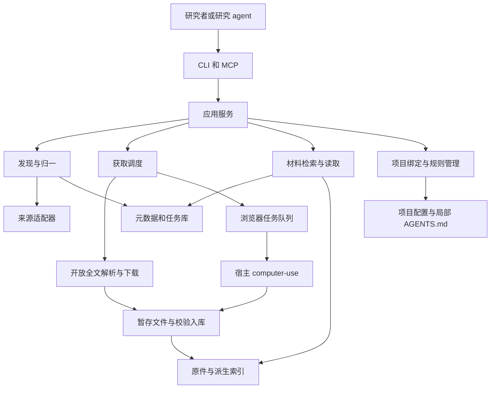

# 科研文献基础组件设计

状态：设计基线。接口版本：v0.1。日期：2026 年 11 月 2 日。当前实现、扩大后的来源范围与设计差异见[实现状态](implementation.md)。

Research Base 为研究者和 agent 提供可重复使用的文献收集、全文获取、材料组织与读取能力。它既可独立运行，也可作为现有研究工作流的组件。研究分析由使用它的 agent 完成，内核无需绑定模型供应商。

## 核心原则

1. 以论文、代码、补充材料和数据说明等原件为知识主体。保存的解析内容和索引应可从原件重建。
2. 整理以便于查找和使用为目标。首版不要求逐篇知识卡、证据链文档、阅读证明或固定的分析模板。
3. 对纳入集合的论文尽量取得全文。阅读排序只影响当前任务的上下文，不自动缩减全文获取范围。
4. 从开放接口发现和获取文献；不能直接获取时，由宿主 agent 使用实验室内网的现有浏览器访问会话接续。
5. 用短规则明确研究行为，用工具提供材料入口。在研究关键节点参考前沿，允许对现有研究提出不同路线。
6. 同一份内核能力供 CLI、MCP 和宿主适配器使用；接入某个 agent 不应另建文献库或复制业务逻辑。

## 用户流程和范围

研究者先建立 collection，配置方向、关键词、时间和来源。检索产生候选文献，研究者或宿主 agent 确定纳入项；也可以显式选择把整次检索结果纳入。组件随后尝试获取每一篇纳入论文的全文，并保持后台任务可续接。

研究项目绑定 collection 后，agent 在研究启动、方向变化、方法选择、实验设计、创新性评估和结果解释等节点查询相关文献，再按任务读取具体论文、章节或代码材料。组件不要求每轮对话重复检索。

检索可以分页到来源结果耗尽，也可以因研究者设置的时间、请求或费用预算暂停；暂停必须保留游标和原因。局部检索的结果不应被描述为全领域所有文献。系统不以任意的前 N 篇限制纳入后的全文获取。

## 首版范围

| 首版包含 | 后续扩展 |
| --- | --- |
| 单机库、多 collection、多本地项目绑定 | 实验室多用户服务、权限和远程文件上传 |
| OpenAlex 和 Crossref 检索与元数据归一 | PubMed、arXiv 检索、Semantic Scholar 等领域来源插件 |
| OpenAlex 全文入口、来源公开 PDF、已知 arXiv PDF 的解析下载 | 更多开放全文解析器和专门来源插件 |
| 主文 PDF 批量获取与校验；材料 URL 和手动文件导入 | 自动补充材料发现、仓库快照及数据资产下载 |
| 同机浏览器任务交接和一个真实宿主的操作说明 | 多宿主专用插件、无人值守浏览器工作者 |
| 分页文本提取、全文检索、按页读取 | OCR、复杂表图解析、语义检索和代码符号索引 |
| CLI、最小 MCP、AGENTS.md 接入模板 | 通用钩子框架、图形管理界面 |
| 手动执行更新检索、JSONL 和 BibTeX 导出 | 定时监测、更正撤稿同步和跨库同步 |

Crossref 作为第二个检索来源及 DOI 元数据补充，不被当作全文库。首版用于验证多源合并和完整使用闭环；实际学科覆盖应在试点后补充专业来源。arXiv 的已知标识符全文解析与 arXiv 的检索适配器是两个不同能力。

## 模块边界



| 模块 | 负责 | 不承担的职责 |
| --- | --- | --- |
| 来源适配器 | 将提供方查询变成统一候选记录，返回分页游标与来源错误 | 不在适配器中写项目规则或生成研究结论 |
| 身份和集合管理 | 标识符归一、重复检测、版本关联、候选与纳入状态 | 不靠模糊标题匹配直接合并不同论文 |
| 全文解析器与下载器 | 发现公开全文位置，执行有重试能力的流式下载 | 不控制浏览器登录会话 |
| 获取调度器 | 对纳入文献创建任务，选择接口或浏览器路径，续接失败任务 | 不假定有 MCP 就具有 computer-use 能力 |
| 校验与材料库 | 文件身份和格式检查、去重、原子入库、原件管理 | 不评价论文科学结论是否正确 |
| 解析与检索 | 按页提取文本、建立索引、检索并读取需要的部分 | 不把解析失败视作没有内容或已完成阅读 |
| 上下文准备 | 根据当前任务提供相关文献、匹配位置和更新提示 | 不自动撰写厚重综述或声称模型理解了论文 |
| 项目接入 | 绑定集合，只管理局部规则区块和自身配置 | 不修改用户全局规则或传播到其他项目 |
| CLI 与 MCP | 校验输入、调用应用服务、转换结果 | 不各自维护一套下载和存储逻辑 |

适配器首版通过显式注册的 Python 模块接入，无需先建设动态插件市场。新来源实现 `search` 和 `resolve` 等约定接口即可；浏览器工作者使用独立交接协议。Skill 只负责描述使用方法。

## 数据模型

文献身份、版本和实际文件分开管理。同一研究工作的预印本与正式版可关联到一个 `paper_id`，不同版本保留独立 `version_id`。同一版本的 PDF、XML、补充材料和代码关联分别使用 `material_id`。这些 ID 一旦生成保持稳定。

| 实体 | 最少字段和关系 |
| --- | --- |
| Paper | `paper_id`、显示标题、作者、主题、首选 `version_id`、创建和更新时间 |
| Version | `version_id`、`paper_id`、版本类型、标题、作者、发表日期、来源页；类型允许 `unknown` |
| Identifier | 命名空间、归一值、`version_id`；如 DOI、OpenAlex ID、带版本的 arXiv ID；命名空间内设置唯一约束 |
| Material | `material_id`、`paper_id`、可空 `version_id`、用途、格式、远程 URL、相对对象路径、SHA256、获取和解析状态 |
| Collection | `collection_id`、名称、研究范围和默认配置、检索计划修订号；完整检索时间按计划指纹记录 |
| Membership | `collection_id`、`paper_id`、`candidate / included / excluded`、可选标签、加入来源 |
| Job | `job_id`、类型、集合、状态、检索或获取配置快照、分页检查点、计数和错误摘要 |
| Task | `task_id`、任务类型、论文和目标材料、状态、重试次数、租约、幂等键和交回结果 |
| JobTask | `job_id`、`task_id`、关联状态；多个 job 可等待同一获取目标，取消单个关联不取消其他请求 |
| Chunk | 材料、提取器版本、PDF 页码或章节、文本；作为派生索引，可删除后重建 |

元数据的来源 ID、获取时间和原始响应缓存用于去重、更新和故障排查，属于机器运行记录。无需把它们再写成逐篇证明文档。

### 身份合并

- DOI 去除 URL 前缀后按规范比较；同 DOI 的重复检索记录并入已有关联版本。
- arXiv 基础编号关联研究工作，`v1`、`v2` 等保留版本差异。出版 DOI 与预印本编号之间优先使用来源明确提供的关联。
- 不同来源的 ID 可能对应不同粒度。来源记录发生标识冲突时保留冲突，不能覆盖已有唯一关系。
- 无明确标识符关联时，标题、作者和年份只产生待确认重复建议。宁可暂时保留两条，也不误合并。
- 版本归属尚不确定的已下载文件可关联 Paper 并标记 `unknown`；不得根据下载入口直接标成正式版。
- 文件 SHA256 只表示字节相同，不用于证明两篇论文或两个版本在学术身份上相同。

### 状态分开表示

Material 的获取状态为 `external / staged / available / rejected`，解析状态为 `not_started / ready / empty / failed`。元数据可用、全文可用、文本可检索是三个不同状态。

检索结果和上下文应显示 `fulltext_available`、`text_searchable`、`version_kind`。只有摘要时标记 `content_scope=abstract_only`。扫描 PDF 即使成功入库，也可能是全文可打开但暂不可检索。

## 文件和项目组织

```text
<library_root>/
  library.json                  # 库身份和格式版本
  catalog.sqlite                # 元数据、集合、任务与 FTS 索引
  objects/sha256/<前两位>/<hash> # 原件按内容寻址，不依赖标题作文件名
  derived/<material_id>/<parser_version>/
    pages.jsonl                 # PDF 物理页码从 1 开始
    text.txt
  exports/                      # JSONL、BibTeX 等可移植导出
  .staging/browser/<task_id>/<lease_id>/
  .state/                       # 锁和未完成写入的恢复记录

<research_project>/
  AGENTS.md                     # 原有规则加 Research Base 受管区块
  .research/
    config.yaml                 # 可提交的项目绑定
    overview.md                 # 可选，研究者或 agent 维护的短方向导航
    references.bib              # 显式导出，避免绑定时自动改写
    state/                      # 绑定状态、锁和恢复记录，不提交
```

`catalog.sqlite` 是运行中的元数据真源，JSONL/BibTeX 是导出而非第二个可写数据库。备份应覆盖数据库和 objects；derived 可重建。备份使用 SQLite 备份接口或停止写入后的完整拷贝，不在写入中只复制主数据库文件。

原件路径相对 `library_root` 保存，文件扩展名由材料类型记录。读取和导出时提供合适的展示名。全局配置把逻辑 `library_ref` 映射到当前机器的库目录；项目配置不提交个人磁盘路径、凭据或浏览器会话数据。

首版支持同机多个调用方，通过 SQLite 事务、任务租约和短时文件锁协调。数据库应位于本地磁盘；直接把 SQLite 文件放在共享网盘供多台机器同时写入不属于首版支持方式。未来通过服务访问共享库，而非共享可写数据库文件。

## 检索和上下文策略

外部发现使用研究者或宿主提供的关键词、时间范围和来源专属检索式。内核不依赖 LLM 扩写研究方向；宿主可先生成同义词和查询计划再调用。保存实际查询、来源、时间、分页进度与预算停止原因即可。

本地首版使用 SQLite FTS5 检索标题、摘要和分页全文。将相关性与时间作为可调排序因素，保留经典文献和最新研究的入口，不用引用量替代相关性。来源失效和单篇解析失败不能让整个集合不可检索。

默认分词对中文存在限制。首版需提供 CJK 连续字符串的参数化子串检索回退，并在返回值说明 `search_mode`；中文专用分词与向量检索作为后续插件。关键词检索未命中不等于文献中不存在该研究点。

`prepare_context` 复用本地检索，按可配置字符预算返回任务相关论文、简短摘要或匹配片段、页码及原件入口。默认建议最多 8 篇、正文 12000 字符；上限只限制此次返回，不影响集合和获取任务。返回截断状态、继续读取方法与未取得全文的相关项。

方向的新鲜度按实际检索计划记录。计划指纹由归一化后的查询、来源及各来源检索式、固定时间范围和其他影响召回的参数计算；请求预算、运行时间和游标不改变指纹。开放截止时间 null 表示检索至执行时，实际截止时间记录为本次 coverage_through，定期更新不必更换同一计划指纹。

只有某计划的所有启用来源均完成，才记录该计划的完整检索时间；失败或预算暂停不能刷新。查询、来源或固定时间范围变化后，新计划没有完成记录即报告 scope_changed 或 never_completed。对局部问题做的临时检索不刷新其他方向计划的新鲜度。`prepare_context` 只提示过期或缺口，不隐式启动搜索下载。

配置优先级为显式请求参数、项目默认值、Collection 默认值。项目的 research 字段是本项目的方向说明，discovery/acquisition 等是调用默认值；attach 和读取配置均不回写共享 Collection。只有显式集合更新操作才改变库中默认配置。实际有效配置及计划指纹保存在每次 job 中，便于续接和判断范围。

## 建议技术选型

| 部分 | 首版建议 | 选择理由 |
| --- | --- | --- |
| 运行时 | Python 3.11 或更高版本，首要适配 Windows | 便于文件处理、来源适配和现有科研脚本调用 |
| 数据与查询 | SQLite、FTS5、版本化迁移 | 单机可安装和备份，无需独立数据库服务 |
| 请求与数据校验 | httpx、Pydantic | 统一超时、重试和请求响应类型 |
| CLI 与配置 | Typer、PyYAML | 同一内核用于命令行和脚本；YAML 使用安全加载 |
| PDF 文本 | pypdf 的分页提取，结构化来源文本作为可选补充 | 首版提供可用文本和页码；不承诺复杂版式还原 |
| MCP | 官方 Python SDK、stdio 入口 | 首版本地接入，协议细节交给 SDK |
| 检查 | pytest、离线来源样本、少量显式联网冒烟检查 | 稳定验证核心逻辑，避免测试依赖实时搜索排序 |

这些是实施默认建议，具体依赖版本在建立工程时按官方兼容信息锁定。首版不安装向量数据库、浏览器驱动或模型 SDK。

## 公开接口依据

以下是来源能力依据，具体适配细节在开发时核对，不在方案中写死服务配额或费用。

- [OpenAlex API](https://help.openalex.org/api/) 提供作品查询和关联数据，可作为通用发现来源。
- [OpenAlex 全文说明](https://help.openalex.org/access/fulltext/) 提供部分文献的 PDF 和 TEI XML 入口；适配器须检查实际内容是否存在及当前用量预算。
- [Crossref REST API](https://www.crossref.org/documentation/retrieve-metadata/rest-api/) 提供成员及可信来源登记的元数据，全文链接是否存在按记录处理。
- [arXiv API 手册](https://info.arxiv.org/help/api/user-manual.html) 可作为后续检索适配器的依据；首版仅处理已知论文的公开 PDF 位置。
- [MCP 架构](https://modelcontextprotocol.io/docs/learn/architecture) 定义工具和资源的连接能力，宿主仍负责上下文使用和浏览器操作。
